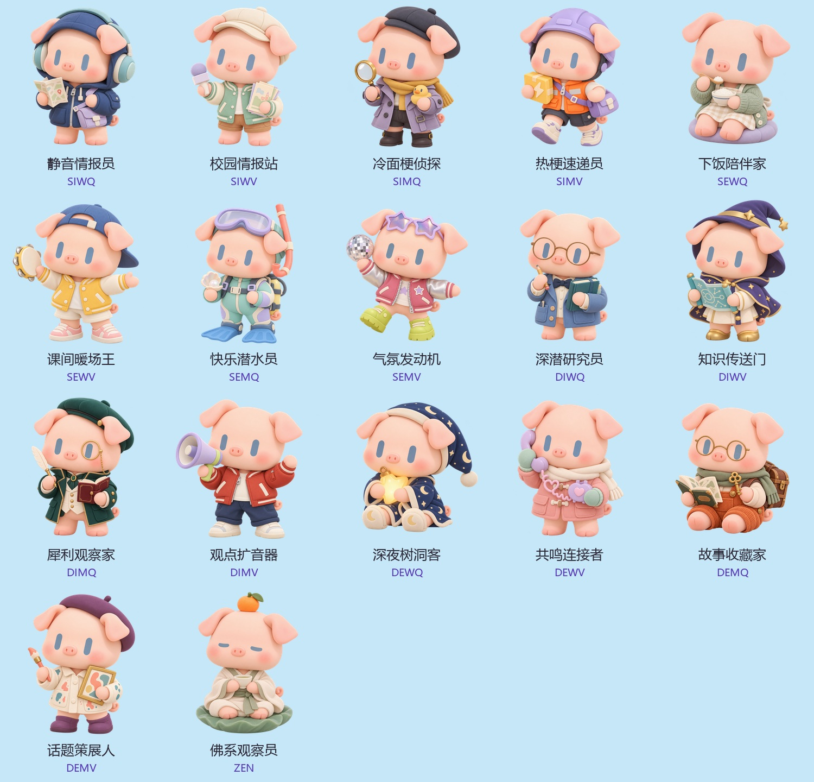

# 小猪人格换装图鉴

17 款小猪以同一脸型、简洁蓝色椭圆眼睛及搪胶材质为基础，通过服装、道具和姿势区分人格。全部使用内置 image_gen 工具独立生成，保留透明背景。768 像素图片用于结果与分享卡，384 像素图片用于首页环绕布局。

## 生图提示词

每款的完整提示词由下列共用提示词、参考图要求及对应人格的 Outfit 三部分组成。首款使用用户提供的两张图作为参考：图一仅取材质和简洁表情，图二仅取首页构图。其余 16 款均将首款 SIWQ 小猪作为形象参考。

### 共用提示词

> Use case: stylized-concept. Asset type: one original collectible pig personality figurine, for a campus personality quiz, result page and share card. STYLE REFERENCE: first user image is a simple peach-colored sheep vinyl toy. Match its SUPER SIMPLE FACE, soft matte seamless molded vinyl, very large rounded head, tiny stubby body, minimal painted long vertical muted BLUE oval eyes, tiny line mouth, subtle apricot blush, soft pastel finish. TRANSFORM THE SPECIES TO A PIG: one pale peach-pink pig, small soft oval protruding snout with two tiny nostrils, two rounded triangular floppy pig ears, a tiny curled pig tail. NO sheep wool, NO sheep horns, no animal costumes, no fur texture, NO realistic pig anatomy. Keep the same pig face and body across this whole clothing series; distinguish personality ONLY by outfit, hat, accessories and pose. Adult collector art toy, not a realistic animal, not anime, not plush. Head roughly 60% of height, short legs, tiny rounded trotters. Simple quietly cute expression, no giant sparkly anime eyes, no human hair, no teeth. A SINGLE full-body pig figure, full hat and all feet in frame, centered at 80% square frame, front three-quarter product view, gentle studio light. Isolated on GENUINELY TRANSPARENT alpha background, no colored rectangle, no scene, no backdrop, NO TEXT OR LOGOS, no labels, no collage, no extra characters.

### 后续换装参考图要求

> Image 1 is the MASTER PIG IDENTITY AND MATERIAL reference. Keep its pig face, blue oval painted eyes, snout, ear design and proportions. COMPLETELY REPLACE ALL ITS CLOTHING AND PROPS with the following outfit; remove the original headphones, hoodie, map and satchel unless explicitly requested here.

### 每种人格的服装

**SIWQ · 静音情报员**

`siwq.webp` / `siwq-small.webp`

> Personality: 静音情报员. Outfit: Navy-blue hooded utility jacket, muted aqua over-ear headphones, tiny pale lavender crossbody satchel, holding a folded cream campus map. Slight head tilt, quietly attentive posture.

**SIWV · 校园情报站**

`siwv.webp` / `siwv-small.webp`

> Personality: 校园情报站. Outfit: Mint-green varsity jacket with cream sleeves, cream newsboy cap, caramel shorts, holding a small lavender microphone and pastel campus leaflets WITHOUT ANY TEXT. Friendly raised hand.

**SIMQ · 冷面梗侦探**

`simq.webp` / `simq-small.webp`

> Personality: 冷面梗侦探. Outfit: Dusty lilac detective trench coat, charcoal beret, mustard scarf, small dark ankle boots, holding a gold magnifying glass and a tiny yellow rubber duck prop. Deadpan curious posture.

**SIMV · 热梗速递员**

`simv.webp` / `simv-small.webp`

> Personality: 热梗速递员. Outfit: Tangerine courier vest, plain lavender safety helmet, dark shorts, cream chunky sneakers, purple crossbody delivery bag, carrying a yellow lightning-shaped parcel. Lively stepping pose.

**SEWQ · 下饭陪伴家**

`sewq.webp` / `sewq-small.webp`

> Personality: 下饭陪伴家. Outfit: Sage knitted cardigan over a cream gingham apron, seated on a small lilac cushion, holding a tiny bowl of rice and rounded spoon. Cozy relaxed posture, simple blue eyes.

**SEWV · 课间暖场王**

`sewv.webp` / `sewv-small.webp`

> Personality: 课间暖场王. Outfit: Honey-yellow varsity jacket with cream sleeves, a backwards muted blue baseball cap, cream shorts and pink sneakers, holding a small tambourine. Welcoming open-arm stance.

**SEMQ · 快乐潜水员**

`semq.webp` / `semq-small.webp`

> Personality: 快乐潜水员. Outfit: Pastel mint wetsuit, lavender diving goggles above eyes on forehead, coral snorkel, blue flippers, tiny lemon air tank, holding one small pearl shell. Full pig face remains visible.

**SEMV · 气氛发动机**

`semv.webp` / `semv-small.webp`

> Personality: 气氛发动机. Outfit: Dusty rose party bomber jacket with silver sleeves, lilac star glasses resting above eyes, lime chunky boots, holding a tiny mirror disco ball. Friendly dancing pose, no wings or horns.

**DIWQ · 深潜研究员**

`diwq.webp` / `diwq-small.webp`

> Personality: 深潜研究员. Outfit: Dusty blue lab coat, round thin bronze reading glasses over simple blue eyes, navy bow tie, cream shirt, holding a thick teal research notebook and a small pencil. Thoughtful upright posture.

**DIWV · 知识传送门**

`diwv.webp` / `diwv-small.webp`

> Personality: 知识传送门. Outfit: Deep violet scholar cape with tiny molded gold stars, small matching pointed scholar hat, cream tunic, tiny golden shoes, holding an open turquoise scroll with only abstract line diagrams. No magical animal features.

**DIMQ · 犀利观察家**

`dimq.webp` / `dimq-small.webp`

> Personality: 犀利观察家. Outfit: Deep emerald high-collared tailored coat, cream waistcoat, a single tiny gold monocle over one simple blue eye, holding a burgundy observation journal and quill. Quiet self-assured posture.

**DIMV · 观点扩音器**

`dimv.webp` / `dimv-small.webp`

> Personality: 观点扩音器. Outfit: Terracotta red flight jacket, navy trousers, cream sneakers, holding a lavender megaphone with lime handle. Confident grounded stance and one raised little trotter.

**DEWQ · 深夜树洞客**

`dewq.webp` / `dewq-small.webp`

> Personality: 深夜树洞客. Outfit: Midnight blue moon-pattern night robe and soft sleeping cap, cream slippers, seated while hugging a small warm-gold star lantern. Gentle comforting posture.

**DEWV · 共鸣连接者**

`dewv.webp` / `dewv-small.webp`

> Personality: 共鸣连接者. Outfit: Peach-pink duffle coat, thick cream scarf and mint mittens, holding a lavender old-fashioned telephone receiver with a heart-shaped coiled cable and small heart-shaped base. Attentive listening pose.

**DEMQ · 故事收藏家**

`demq.webp` / `demq-small.webp`

> Personality: 故事收藏家. Outfit: Rust-orange corduroy overalls, sage scarf and small round spectacles, tiny wooden story chest backpack, holding an open miniature storybook with blank/abstract pages and a brass key. Cozy seated pose.

**DEMV · 话题策展人**

`demv.webp` / `demv-small.webp`

> Personality: 话题策展人. Outfit: Plum artist beret, cream painter smock with a few teal and coral paint marks, plum ankle boots, holding a small gold-framed inspiration board of abstract colored shapes and a coral paintbrush. Playful curator posture.

**ZEN · 佛系观察员**

`zen.webp` / `zen-small.webp`

> Personality: 佛系观察员. Outfit: Loose oatmeal wrap robe, sage sash, seated cross-legged on a small jade lotus-leaf cushion, holding a cream teacup, tiny orange fruit resting on head. Calm closed blue line eyes; same pig face and snout.

高清 PNG 原图及每款完整提示词保存在本机 Downloads/cdut-pig-art 文件夹中。
